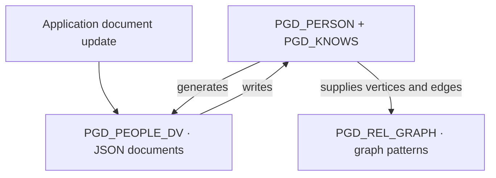

# Property graphs in ADB-S 26ai — a worked demo

Documentation checked: 20 November 2026. ADB-S means Autonomous AI Database Serverless.

**24 November 2026 D2.1 revision:** the endpoint validation now compares
numeric IDs in PL/SQL, avoiding the correlated `NOT EXISTS` statement that
reported `ORA-40444`. Run only
[walkthrough/D2-workaround.sql](walkthrough/D2-workaround.sql) against the
existing D1 views, then continue to D3 if it passes. This is a proposed
workaround, not a live-verified fix or a confirmed Oracle defect diagnosis.
[Details and diagnostics](walkthrough/D2-workaround.md) explain the change.
The PDF and optional chapter script include the same revision.

**24 November 2026 correction:** algorithm seed identifiers now use
`SYS_CONTEXT('USERENV', 'SESSION_USER')` instead of bare `USER`, following the
reported `ORA-00984` in PDF steps E13.1 and E14.1. Run these checks as the graph
owner. Existing installations can rerun only those two blocks; no setup or
cleanup is needed. Live ADB verification of this revision remains pending.

**Step-by-step PDF:** open [adb26ai-property-graphs-step-by-step.pdf](adb26ai-property-graphs-step-by-step.pdf)
for a 49-page guided lab, with explanations, expected answers, corrected privileges,
and all five `DBMS_OGA` functions. Its 60 highlighted code panels are selectable
text, and each is wholly on one page. Matching commands, with the same step IDs,
are in [walkthrough/README.md](walkthrough/README.md). Use either this guided setup
or the original core runner in a fresh schema; both create the same objects.

**A SQL property graph describes how existing rows become vertices, directed edges,
labels, and properties. It does not make a second stored copy of those rows.**
`GRAPH_TABLE` matches a graph pattern and returns ordinary SQL rows. [3, 5]

This kit demonstrates the same five people and seven relationships in three data
models. Start with `property-graphs-demo.html` for the interactive walkthrough,
then run the SQL. The browser simulation works offline and does not connect to ADB.

## What is supported, and what this demo establishes

| Design | Implementation in this kit | Support boundary |
|---|---|---|
| Relational tables → graph | `PGD_PERSON`, `PGD_KNOWS` → `PGD_REL_GRAPH` | Native SQL property graphs in ADB 26ai. Uses enforced PK/FK constraints. [1, 3] |
| JSON collections → graph | `PGD_J_PERSON`, `PGD_J_KNOWS` → `PGD_JSON_GRAPH` | Collection expression columns provide typed keys; JSON_VALUE defines properties. Uses documented features in combination. No graph-over-view dependency. [4, 6, 7, 11] |
| Duality view and graph share tables | `PGD_PEOPLE_DV` and `PGD_REL_GRAPH` both use the relational tables | Recommended here. A document update writes the very rows queried by the graph. No graph-over-view dependency. [8, 9, 10] |
| Duality document → projection views → graph | `PGD_PEOPLE_DV` → `PGD_DV_PERSON_V` / `PGD_DV_KNOWS_V` → `PGD_DV_GRAPH` | Optional composition. Graphs over views require DB RU **23.26.1+**. Oracle documents views and JSON_TABLE as graph sources, but I did not find a dedicated graph-over-duality certification example. Run Part D on the target instance. [2, 3] |

The product name **26ai is not a sufficient patch-level check**. Its database
version string can begin with 23; Graph Server/Client 26.4 is a separate version.
Record `PRODUCT_COMPONENT_VERSION.VERSION_FULL`, then execute the included checks.

Do not use `KEY(DATA)` or a JSON path inside `KEY(...)`. Graph keys here are named,
scalar SQL columns. Collection internals such as `RESID` are not application keys.
Part B uses explicit numeric document identifiers and derives numeric virtual columns.
Part D extracts numeric keys from the duality JSON into ordinary view columns. [4, 11]

## Run the demo

Use a dedicated empty schema on your ADB-S 26ai instance. The scripts create only
objects prefixed `PGD_`. Existing `PGD_` objects cause preflight to stop. DDL commits;
setup is not an all-or-nothing transaction. Cleanup is explicit, not automatic.

Have your ADB administrator provision the demo schema with table space quota and
the following own-schema privileges. Replace `PG_DEMO` with its actual name:

```sql
GRANT CREATE SESSION, CREATE TABLE, CREATE VIEW, CREATE SYNONYM,
      CREATE PROPERTY GRAPH
TO PG_DEMO;
ALTER USER PG_DEMO QUOTA 50M ON DATA;
```

The only graph-specific system privilege needed for this demo is
`CREATE PROPERTY GRAPH`. All graphs and source objects belong to the demo user.
The owner can query and drop its own graphs. [4, 13, 14, 15]

| Operation | Authorization |
|---|---|
| Create a graph in your schema | `CREATE PROPERTY GRAPH` system privilege |
| Query your own graph | Ownership; no additional grant |
| Drop your own graph | Ownership; no additional grant |
| Let another user query your graph | `READ` or `SELECT` object privilege on that graph |
| Drop a graph in another schema | `DROP ANY PROPERTY GRAPH`; not required by this demo |

For example, after Part A, the graph owner can share the graph with an existing
reader account:

```sql
GRANT READ ON PROPERTY GRAPH pgd_rel_graph TO PG_READER;
-- SELECT can be used instead of READ in this object grant.
```

`DROP PROPERTY GRAPH pgd_rel_graph` is valid DDL. Neither `DROP PROPERTY GRAPH`
nor `READ PROPERTY GRAPH` is a grantable system privilege. The preflight check
also excludes the invalid name `SELECT PROPERTY GRAPH`. The grants above follow
the SQL Language Reference. [13, 14]

To inspect the privilege names recognized by your database, use
`SYSTEM_PRIVILEGE_MAP`; `SESSION_PRIVS` shows privileges enabled for your session:

```sql
SELECT name FROM system_privilege_map
WHERE name LIKE '%PROPERTY GRAPH'
ORDER BY name;
```

Use your existing ADB connection method; the kit contains no credentials, wallet,
or network configuration. These scripts run in the database using SQL/PGQ. A separate
PGX server, in-memory graph load, or Graph Studio session is not required.
Keep client autocommit disabled and run each SAVEPOINT/update/query/ROLLBACK sequence
in the same session. The temporary changes are intentional teaching steps.

**SQLcl / SQL*Plus:** connect as the demo user, change to this extracted directory,
and execute `@run_core.sql`. This wrapper stops on SQL errors. When core completes,
run `@run_optional.sql` if the target supports graphs over views.

**Database Actions:** open SQL, load `demo_core.sql`, and use **Run Script**. Inspect
the output from the top and stop at the first error; do not treat a later result as
proof that earlier statements succeeded. For Part D, run
`sql/05_optional_graph_from_duality.sql` after successful core setup. Individual
chapter scripts are also suitable for stepping through one statement at a time.

| Step | File | What to observe |
|---|---|---|
| 0 | `sql/00_preflight.sql` | Actual database version, effective privileges, empty demo namespace |
| A | `sql/01_relational.sql` | Tables, constraints, data, and graph DDL |
| A queries | `sql/02_graph_queries.sql` | One hop, two hops, equivalent joins, route counts, cycles, live DML |
| B | `sql/03_json_collections.sql` | True JSON collections; virtual scalar keys; same graph query |
| C | `sql/04_duality_shared_tables.sql` | JSON updates visible through relational SQL and the original graph |
| Checks | `sql/06_validate_core.sql` | Assertions and source-object metadata |
| D, optional | `sql/05_optional_graph_from_duality.sql` | Flatten nested documents to graph elements; verify on the target |
| E, algorithms | `sql/07_algorithms.sql` | Five DBMS_OGA algorithms; database RU 23.26.2+ |
| E, optional duality | `sql/08_algorithms_duality.sql` | Algorithms on the successful Part D projection |
| Cleanup, explicit | `sql/99_cleanup.sql` | Drops this kit's exact objects; never run on valuable demo data |

## The relational model and its graph mapping

`PGD_PERSON(person_id PK, person_name, city)` stores entities.
`PGD_KNOWS(edge_id PK, src_id FK, dst_id FK, since_year)` stores directed links.
The two FKs point to the same person table. Explicit source/destination mappings
avoid ambiguity about which FK means which direction.

| Relational component | Graph role | Example |
|---|---|---|
| A PGD_PERSON row | Vertex labeled `person` | Person 1, Alice |
| person_id | Vertex identity | 1 |
| person_name, city | Vertex properties `name`, `city` | Alice, Madrid |
| A PGD_KNOWS row | Edge labeled `knows` | Edge 101 |
| src_id, dst_id | Source and destination | Alice → Bob |
| since_year | Edge property | 2020 |

A foreign key alone does not automatically create a graph edge. The DDL specifies
the rows that act as edges and which columns identify their endpoints. This demo
models one directed link per row; the reverse direction is not implied.

```sql
CREATE PROPERTY GRAPH pgd_rel_graph
  VERTEX TABLES (
    pgd_person AS people KEY (person_id)
      LABEL person PROPERTIES (person_id, person_name AS name, city)
  )
  EDGE TABLES (
    pgd_knows AS links KEY (edge_id)
      SOURCE KEY (src_id) REFERENCES people (person_id)
      DESTINATION KEY (dst_id) REFERENCES people (person_id)
      LABEL knows PROPERTIES (edge_id, since_year)
  )
  OPTIONS (ENFORCED MODE);
```

## The question: who is two outgoing links from Alice?

```sql
SELECT start_name, via_name, target_name
FROM GRAPH_TABLE (pgd_rel_graph
  MATCH (a IS person)-[e1 IS knows]->(b IS person)
                     -[e2 IS knows]->(c IS person)
  WHERE a.person_id = 1
  COLUMNS (a.name AS start_name, b.name AS via_name,
           c.name AS target_name)
)
ORDER BY via_name, target_name;
```

| start_name | via_name | target_name |
|---|---|---|
| Alice | Bob | Diego |
| Alice | Bob | Elena |
| Alice | Carla | Diego |

Three path matches reach two distinct people. The route through Bob and the route
through Carla are different matches even though they both reach Diego.
`GROUP BY target_name` produces Diego = 2 and Elena = 1. The explicit two-edge
pattern does not mean shortest path and does not compute an algorithm such as
PageRank. The arrow direction matters.

`(a IS person)` binds a labeled vertex. `-[e IS knows]->` binds a directed edge.
`WHERE` filters the pattern and `COLUMNS` chooses the ordinary SQL result fields.
The outer query can sort, join, and aggregate those fields. [5]

The equivalent joins are in Part A. The benefit shown here is that relationship
patterns are explicit; this small demo makes no performance claim. Actual plans,
selectivity, indexes, and data distribution determine runtime.

## JSON collection: documents are the stored data

Example person: `{"_id":1,"name":"Alice","city":"Madrid"}`.
Example edge: `{"_id":101,"src":1,"dst":2,"since":2020}`.

Part B uses **two real JSON collection tables**. There is one person document per
vertex and one relationship document per edge. It adds invisible expression
columns with `JSON_VALUE(... RETURNING NUMBER)` for identities and endpoints, then
uses JSON expressions for graph properties. The documents remain the stored data;
the virtual columns are calculated and the graph adds metadata. [6, 7]

The graph is in **TRUSTED MODE**. It does not introduce PK/FK enforcement for the
JSON fields. The supplied validation rejects null/duplicate graph identifiers and
dangling endpoints for the sample. Revalidate after changes or enforce these rules
at write time in a real application. Stable numeric IDs are a deliberate demo
contract: do not coerce mixed string, numeric, and object identifiers blindly.

Part B contains its own sample dataset. A JSON update changes `PGD_JSON_GRAPH`;
it does **not** update Part A. Identical initial values do not create synchronization.

For a collection that embeds relationships in arrays, use a view over JSON_TABLE
to emit one row per array member, as Part D demonstrates. That view-based form
requires graph-over-view support. Before that support, a materialized projection
is an alternative, but it introduces stored data and refresh management.

## JSON relational duality: two interfaces to the same rows

The preferred arrangement is:



Part C exposes each person with an `outgoing` array of links. Oracle generates the
documents from the tables. There is no persisted JSON copy to synchronize. The
sample keeps references as target IDs; it does not recursively nest destination
people, which would be awkward for cycles. [8, 9]

The decisive demonstration is:

```sql
UPDATE pgd_people_dv
SET data = JSON_TRANSFORM(data, SET '$.city' = 'Sevilla')
WHERE JSON_VALUE(data, '$._id' RETURNING NUMBER) = 4;
```

Now the person table and `PGD_REL_GRAPH` both report Diego in Sevilla. The script
queries both and rolls back to Valencia. It then inserts Alice → Elena through
ordinary SQL: the outgoing JSON array and the graph both acquire that edge, then
the script rolls back again. Changes obey normal transaction visibility: the
current session sees its writes, other sessions see committed data according to
their isolation/snapshot rules. [10]

The partial JSON update is a demonstration of shared storage, not an application
optimistic-locking protocol. Full-document client updates should use the appropriate
ETAG concurrency mechanism. Oracle-generated `_metadata` values vary between runs.

## Does a graph literally on top of the duality view make sense?

It can when the document shape is the intended integration contract or access
boundary. Part D flattens the duality document into two SQL views, then maps those
views into a graph. `outgoing[*]` becomes edges; the parent `_id` supplies the source.
The stored `edge_id` supplies stable identity even if array order changes.

This is an **inference from the documented composition of SQL views, JSON_TABLE,
and duality JSON querying**, not a claim that Oracle publishes this exact integration
as a dedicated feature. Part D explicitly tests the composition on your instance.
It uses TRUSTED mode because graph-over-view creation does not support ENFORCED
mode. The graph reads the projected rows without a refresh job. [2, 3]

For this model I recommend Part C for application design: it names relational
identities and relationships directly, retains enforced graph constraints, and
keeps the document API flexible. Part D adds a useful teaching layer and a document
contract dependency. Whether the optimizer eliminates JSON generation/extraction
must be checked in actual execution plans; no performance equivalence is assumed.

## Part E: algorithms with DBMS_OGA

Run `@run_algorithms.sql` after core setup. For Database Actions, open
`sql/07_algorithms.sql` and use **Run Script**, stopping at the first error.
Use a fresh connection as the demo owner, or intentionally finish the prior
transaction. A `ROLLBACK TO` used in the teaching steps may leave the transaction
open. Part E rejects an open transaction before its graph DDL can commit it.

Oracle documents GAF invocation from `GRAPH_TABLE` starting with **database RU
23.26.2**. Check the actual instance version and execute the first query; the
26ai product label and package visibility alone do not prove support. [2]
`EXECUTE` on `SYS.DBMS_OGA` and `SYS.DBMS_GAF` is granted to `PUBLIC` by default.
Use an authorized administrator if package access has been restricted. The owner
can query its graphs; no `READ PROPERTY GRAPH` or `DROP PROPERTY GRAPH` system
grant is introduced. [20]

| Example | Algorithm / query | What to learn |
|---|---|---|
| E1 | `PAGERANK` | Rank the five vertices using the entire directed graph |
| E2 | `PAGERANK` plus a two-hop pattern | Score the full graph, then select and deduplicate Alice's two-hop destinations |
| E3 | `PERSONALIZED_PAGERANK` | Focus the ranking on Alice |
| E4 | `PERSONALIZED_PAGERANK_SET` | Focus it on Alice and Carla together |
| E5 | `WCC` with SQL aggregation | Find connected groups while ignoring edge direction |
| E6a | `BELLMAN_FORD`, all costs = 1 | Find minimum directed hop distances |
| E6b | `BELLMAN_FORD`, explicit effort costs | Find minimum total cost, which may require more hops |
| E7 | `PAGERANK` and `WCC` on `PGD_JSON_GRAPH` | Apply algorithms to graph elements sourced from JSON collections |
| E8 | Assertions | Check score normalization, component membership and both distance results on Oracle |

The walkthrough now includes a selectable algorithm panel. Its calculations are
independent mathematical reference results for the synthetic baseline, **not captured
Oracle output**. The SQL remains to be executed on your ADB-S instance.

An algorithm returns a temporary graph carrying its result properties. The
enclosing `GRAPH_TABLE` can read those properties alongside normal names, cities
and links. Nothing is added permanently to a table or the original graph. [18]
One GAF is allowed per `GRAPH_TABLE`; use separate queries/results when combining
algorithms. Output property names must be new. [16]

E3 prints `VERTEX_ID` so the seed format is visible. In this demo the graph's
element alias is **PEOPLE**, its label is **person**, and its underlying table is
**PGD_PERSON**. These names serve different purposes. The SQL constructs the full
identity using `JSON_OBJECT` and `SYS_CONTEXT('USERENV', 'SESSION_USER')`. It assumes the
original own-schema setup and no `ALTER SESSION SET CURRENT_SCHEMA`. For another
graph or account, obtain the identity from that graph's `VERTEX_ID` output. [16, 17]

E6 creates only `PGD_COST_GRAPH`, another mapping over the same existing person
and relationship tables. It exposes `hop_cost = 1` and a fictional `effort` value
for each edge. Keeping these separate avoids treating `since_year` as a cost.

| Edge | Direction | Effort |
|---|---|---:|
| 101 | Alice → Bob | 1 |
| 102 | Alice → Carla | 9 |
| 103 | Bob → Diego | 2 |
| 104 | Carla → Diego | 1 |
| 105 | Diego → Alice | 1 |
| 106 | Bob → Elena | 1 |
| 107 | Elena → Carla | 1 |

Expected distances from Alice, computed from this sample:

| Destination | Minimum hops | Minimum effort |
|---|---:|---:|
| Alice | 0 | 0 |
| Bob | 1 | 1 |
| Carla | 1 | 3 |
| Diego | 2 | 3 |
| Elena | 2 | 2 |

The cheapest route to Carla is Alice → Bob → Elena → Carla. The function returns
distances, not that route's edge sequence. Oracle's `BELLMAN_FORD` disallows
negative and NULL weights; unreachable vertices get positive infinity. The demo
uses `DEFAULT ON NULL 1` because these input properties are expressions. [16]

The baseline WCC result has one group containing all five people. Compare group
membership rather than a specific numeric component ID. PageRank sorts Diego,
Alice, Carla, Bob, Elena on this sample; personalized scores answer a different
question and can change that order. WCC does not identify tightly knit communities. [17]

The shared-table duality design in Part C already uses `PGD_REL_GRAPH`, so all
relational algorithm examples apply to it. After the optional Part D succeeds,
`sql/08_algorithms_duality.sql` runs PageRank and WCC on `PGD_DV_GRAPH` as an
additional target-instance check of the projected-document composition. The
source design retains the support boundary described in Part D.

Do not run a GAF between an uncommitted update and its rollback in Parts A–C:
Oracle documents that graph-affecting uncommitted changes prevent algorithm
execution. Row-level security on element tables (including through views) and
redacted algorithm input columns also restrict GAF use. [19] Larger graphs need
temporary and undo space; this five-vertex example is not a sizing benchmark.

## Validation and limits

The author checked the SQL against current Oracle documentation, computed expected
answers independently from the sample data, and checked the offline walkthrough.
**The SQL has not been executed against an Oracle database in this session.** This
workspace has no ADB connection. The kit includes executable assertions to complete
that validation on your target, including the optional duality projection.

Core success means: 5 vertices and 7 edges in each graph; the three specified two-hop
routes; five duality documents; all temporary updates rolled back. This is a teaching
example, not a scale benchmark. Use the source-object query at the end to confirm
what each graph reads. Do not load the graph into PGX for the live-DML demonstration:
an in-memory analytical graph has its own loading/refresh lifecycle.

If setup stops, keep the first Oracle error and version output. Missing privileges
or quota should be fixed before rerunning in a fresh schema. If Part D fails, the
shared-table duality demonstration remains the intended core solution. To reset,
review and run `sql/99_cleanup.sql` in this demo schema; then rerun core.

## Oracle sources

1. [SQL property graphs in Autonomous Graph Studio](https://docs.oracle.com/en/cloud/paas/autonomous-database/csgru/create-graph-existing-relational-tables.html)
2. [Database RU feature boundaries](https://docs.oracle.com/en/database/oracle/property-graph/26.4/spgdg/key-property-graph-features-oracle-ai-database-26ai.html)
3. [Graph creation, views, JSON_TABLE and constraints](https://docs.oracle.com/en/database/oracle/property-graph/26.4/spgdg/creating-sql-property-graph.html)
4. [CREATE PROPERTY GRAPH SQL reference](https://docs.oracle.com/en/database/oracle/oracle-database/26/sqlrf/create-property-graph.html)
5. [GRAPH_TABLE operator](https://docs.oracle.com/en/database/oracle/oracle-database/26/sqlrf/graph_table-operator.html)
6. [JSON collections and virtual columns](https://docs.oracle.com/en/database/oracle/oracle-database/26/adjsn/json-collections.html)
7. [JSON property expressions](https://docs.oracle.com/en/database/oracle/property-graph/26.3/spgdg/json-support-sql-property-graphs.html)
8. [Creating duality views](https://docs.oracle.com/en/database/oracle/oracle-database/26/jsnvu/creating-duality-views.html)
9. [CREATE JSON RELATIONAL DUALITY VIEW](https://docs.oracle.com/en/database/oracle/oracle-database/26/sqlrf/create-json-relational-duality-view.html)
10. [Updating documents through duality views](https://docs.oracle.com/en/database/oracle/oracle-database/26/jsnvu/updating-documents-data-duality-views.html)
11. [CREATE TABLE: JSON collection restrictions](https://docs.oracle.com/en/database/oracle/oracle-database/26/sqlrf/CREATE-TABLE.html)
12. [Graph options in Autonomous Graph Studio](https://docs.oracle.com/en/cloud/paas/autonomous-database/csgru/configure-graph-options-with-modeler.html)
13. [GRANT: system and object privileges (SQL Language Reference)](https://docs.oracle.com/en/database/oracle/oracle-database/26/sqlrf/GRANT.html)
14. [DROP PROPERTY GRAPH: ownership and prerequisites](https://docs.oracle.com/en/database/oracle/oracle-database/26/sqlrf/drop-property-graph.html)
15. [Privileges to query and share a SQL property graph](https://docs.oracle.com/en/database/oracle/property-graph/26.4/spgdg/privileges-query-sql-property-graph.html)
16. [DBMS_OGA: signatures and property arguments](https://docs.oracle.com/en/database/oracle/oracle-database/26/arpls/dbms_oga1.html)
17. [Graph algorithms: examples and meanings](https://docs.oracle.com/en/database/oracle/property-graph/26.4/spgdg/graph-algorithm-functions-supported-dbms_oga.html)
18. [Graph algorithm functions: temporary output graphs](https://docs.oracle.com/en/database/oracle/property-graph/26.4/spgdg/overview-graph-algorithm-function.html)
19. [Graph query and algorithm limitations](https://docs.oracle.com/en/database/oracle/property-graph/26.4/spgdg/supported-feature-and-limitations-when-querying-sql-property-graph.html)
20. [Graph reference: algorithm invocation and privileges](https://docs.oracle.com/en/database/oracle/oracle-database/26/sqlrf/graph-reference.html)

